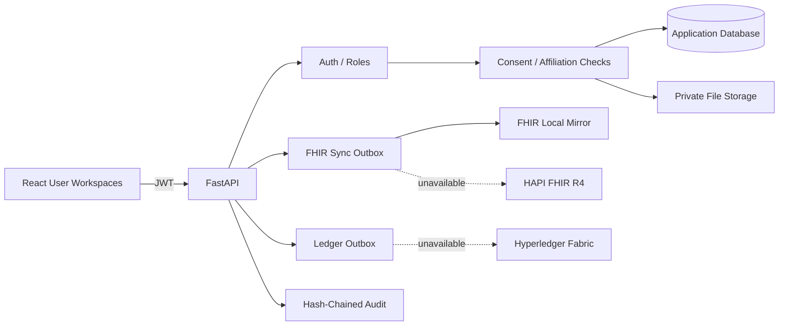
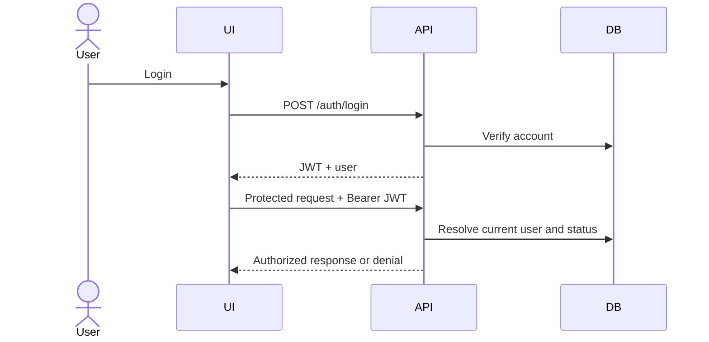
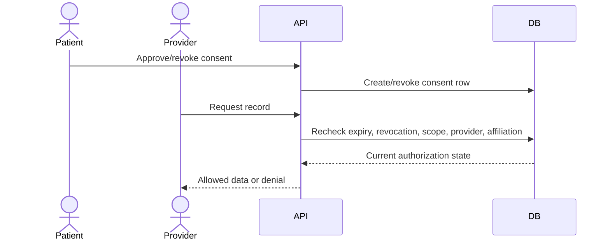
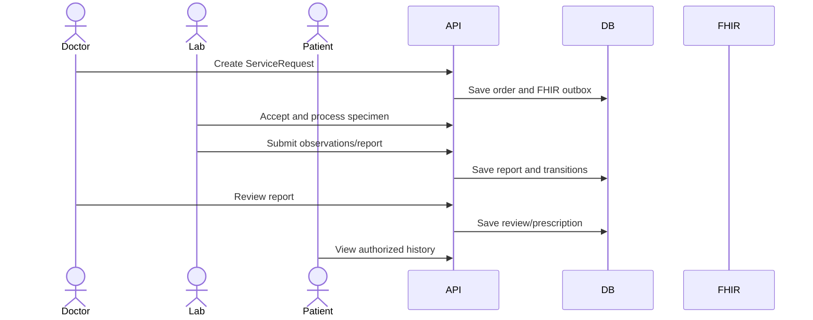
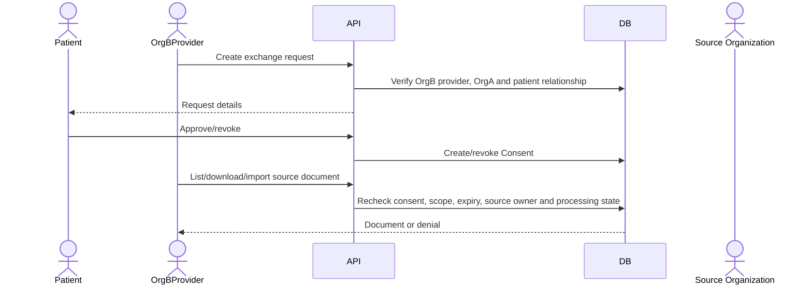
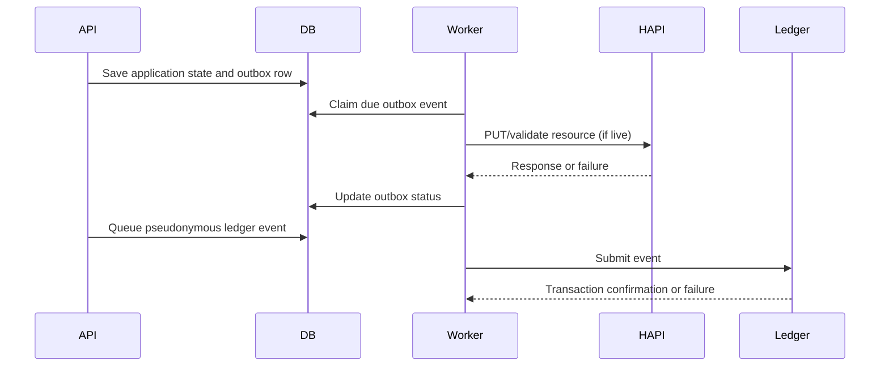

# HealthHarbor — Complete Technical Evaluation and Proofs

**Repository:** `/home/pamarthi-avinash/Downloads/healthcare-exchange`  
**Evaluation date:** 2026-11-28  
**Demo environment:** isolated SQLite database, local authentication, local FHIR mode, Fabric disabled  
**Backend URL:** `http://127.0.0.1:8002`  
**API docs:** `http://127.0.0.1:8002/docs`  
**Frontend URL:** Not started; Node.js/npm and browser automation were unavailable

> This is an evidence-based evaluation. Live HAPI, Hyperledger Fabric, PostgreSQL, ClamAV, Keycloak browser authentication, and frontend browser workflows are not claimed where they were not executed.

## 1. Project overview

HealthHarbor is a consent-aware healthcare exchange prototype built with React/Vite, FastAPI, SQLAlchemy/Alembic, SQLite or PostgreSQL, HAPI FHIR R4 integration paths, and a Hyperledger Fabric outbox. The application database remains authoritative for account ownership, provider verification, organization status, affiliation, consent, document ownership, and clinical workflow state.

The frontend is organized by role: Patient, Physician, Laboratory, Laboratory supervisor/technician, and Administrator. Backend authorization is database-backed and must remain the source of truth; React visibility is presentation only.

## 2. Chronological evaluation history

### Evaluation 1 — Initial architecture and identity

**Verdict:** PARTIAL PASS  
Repository inspection established local JWT authentication, role-based routes, SQLAlchemy models, React workspaces, SQLite development, and PostgreSQL production configuration. Live identity-provider and browser verification remained outstanding.

### Evaluation 2 — Registry and organization workflows

**Verdict:** PARTIAL PASS  
Implemented and locally tested organization/provider applications, approvals, suspensions, affiliations, registry directories, and tenant isolation. PostgreSQL migration and live external verification remained outstanding.

### Evaluation 3 — Care connection and record consent

**Verdict:** PASS locally  
Implemented patient-to-provider care connections and provider record requests. Patient approval creates the existing consent model. Negative owner/tenant tests passed on SQLite.

### Evaluation 4 — Clinical document exchange

**Verdict:** PARTIAL PASS  
Implemented private file storage, document metadata, FHIR DocumentReference mirroring, encryption, scanner lifecycle, duplicate detection, download authorization and revocation checks. Live ClamAV, PostgreSQL and HAPI operations were not verified.

### Evaluation 5 — Production security hardening

**Verdict:** PARTIAL PASS  
Added production startup validation, explicit CORS/trusted-host checks, liveness/readiness endpoints, encryption key validation and scanner fail-closed behavior. Live infrastructure remained unverified.

### Evaluation 6 — FHIR interoperability

**Verdict:** PARTIAL PASS  
Added stable resource builders, FHIR mirror synchronization, FHIR outbox state, retry/permanent-failure handling and reconciliation. Live HAPI create/read/update/search was not verified.

### Evaluation 7 — Cross-hospital exchange

**Verdict:** PASS locally  
Implemented cross-hospital requests, patient approval/revocation, source document listing, document import provenance and consent-gated download. Live cross-hospital/FHIR/Fabric infrastructure was not verified.

### Evaluation 8 — Clinical workflows

**Verdict:** PASS locally  
Implemented lab orders, reports, observations, physician review, prescriptions, report amendment history and consent/authorization checks. The complete synthetic journey passed on SQLite.

### Evaluation 9 — Frontend integration audit

**Verdict:** PARTIAL PASS  
Static diagnostics found no errors in modified React/API files. The Doctor, Sharing and Laboratory workspaces use live API methods. Stale patient clinical data was cleared before refresh, and mutation buttons gained duplicate-submit protections. Node/npm build and browser verification remained unavailable.

### Evaluation 10 — Complete application execution

**Verdict:** PARTIAL PASS  
The backend, API docs, authentication and seeded synthetic workflows ran successfully on an isolated SQLite database on loopback port 8002. Frontend process/browser verification was blocked by unavailable Node/npm and browser tooling.

## 3. Complete feature inventory

| Category | Frontend | Backend | Database | Security | Integration | Evidence |
|---|---|---|---|---|---|---|
| Authentication | Login | `/auth/*` | `users` | JWT, role and subject checks | Local/Keycloak path | Locally tested |
| Patient profile | Sharing/Overview | `/auth/me`, FHIR Patient | `users`, `fhir_resources` | Patient owner checks | FHIR Patient builder | Locally tested |
| Registry | Registry workspace | `/api/v1/*` | organization/provider/affiliation tables | Admin/provider eligibility | FHIR mappings | Locally tested |
| Care connection | Doctor/Sharing views | `/api/v1/care-connections` | `care_connections` | Provider/patient ownership | FHIR outbox | Locally tested |
| Consent | Sharing access | `/consent/*` | `consents` | Revocation, expiry, scope | FHIR Consent | Locally tested |
| Clinical documents | Files page | `/files` | `clinical_files`, FHIR mirror | Consent/document owner checks | HAPI local/mocked, storage | Locally tested |
| Encryption | File status | Document storage | Key ID/version metadata | AES-256-GCM | KMS not implemented | Locally tested |
| Malware scanning | Processing status | Upload lifecycle | processing/scan fields | Fail closed | ClamAV TCP adapter | Adapter only |
| FHIR | Status where exposed | FHIR and sync routers | `FHIRResource`, sync outbox | Backend authorization remains separate | HAPI mocked/local | Locally tested |
| Cross-hospital | Sharing/Doctor | `/api/v1/cross-hospital/*` | exchange/import tables | Scope/consent/affiliation checks | FHIR outbox | Locally tested |
| Prescriptions | Sharing/Doctor | `/api/v1/prescriptions` | prescription/history | Provider/patient consent | MedicationRequest outbox | Locally tested |
| Clinical reviews | Sharing/Doctor | `/api/v1/clinical-reviews` | review table | Consent/resource ownership | FHIR Task-like local state | Locally tested |
| Lab orders | Lab/Doctor | `/fhir/ServiceRequest` | workflow + FHIR mirror | Roles/consent/workflow state | FHIR ServiceRequest | Locally tested |
| Diagnostic reports | Lab/Doctor/Patient | `/fhir/DiagnosticReport` | FHIR resources/workflow/amendments | Lab role/ownership/finalized state | FHIR DiagnosticReport | Locally tested |
| Observations | Lab/Doctor | `/fhir/DiagnosticReport` | FHIR Observation | Workflow assignment/consent | FHIR Observation | Locally tested |
| Audit | Admin | `/audit/*` | hash-chained audit | Admin-only read | Fabric pseudonymous outbox | Locally tested |
| Blockchain | No clinical UI | Ledger outbox | `ledger_outbox` | Pseudonymous payload/hash | Fabric gateway | Mock/unit only |
| Administration | Admin dashboard | `/auth/users`, audit, registry | users/memberships/registry | Platform-admin role | None required for UI | Locally tested |
| Health monitoring | API health | `/health*` | Database readiness | No secrets | Optional FHIR/Fabric/scanner | Locally tested |

## 4. Complete application flow

1. **Authentication:** login endpoint validates credentials and returns an application JWT. `/auth/me` resolves current database user.
2. **Registry:** organization/provider applications are reviewed by platform admins. Provider verification and affiliations are database authoritative.
3. **Care connection:** patient initiates; provider accepts/declines. It does not grant record access.
4. **Consent:** patient grants selected resource types and duration. Revocation updates the application database and FHIR representation is queued.
5. **Document upload:** patient or authorized actor uploads. Filename/content validation, category validation, checksum, private storage and processing state are applied.
6. **Document access:** every read/download rechecks owner or consent, provider status, affiliation, organization status, expiry and scope.
7. **Cross-hospital request:** provider at one organization requests source organization records. Patient approval creates the existing consent record.
8. **Document provenance:** import records preserve source organization, receiving organization, checksum, provider, consent and integrity result.
9. **Laboratory order:** doctor creates a ServiceRequest; laboratory accepts/assigns/starts processing.
10. **Diagnostic report:** technician submits observations and conclusion; laboratory finalizes; amendment creates a history row and FHIR outbox update.
11. **Physician review:** requesting doctor records review status and optional clinical note.
12. **Prescription:** verified provider creates active/draft prescription after consent; terminal transitions preserve history.
13. **FHIR outbox:** resource builders map application state to FHIR; stable IDs prevent random recreation; worker retries or marks permanent failures.
14. **Audit:** security events are appended to a hash chain. Entry #33 remains untouched.
15. **Fabric:** eligible audit events create pseudonymous outbox payloads with hashes and no clinical content.

## 5. Security evaluation

### Authentication

Local JWT signing keys require production configuration. Local auth is intentionally rejected in production startup. Keycloak mode is implemented but live browser/discovery verification was not performed.

### Authorization

`require_roles` and route-level database checks verify current role, provider verification, active affiliation and organization approval. Consent helpers recheck expiry and revocation. Direct document and cross-hospital downloads recheck consent.

### Consent

Care connection, record request and registry affiliation do not independently grant access. Resource scope and expiry are stored in `consents` and checked server-side.

### Files

Uploads use allowlisted extensions/signatures, size limits, safe filenames, generated storage keys and private local storage. Encryption is opt-in. Scanner failure keeps uploads unavailable. Direct storage paths are not exposed.

### Audit

Audit entries are append-only and hash-linked. Administrative audit endpoints require the admin role. Entry #33 remains untouched.

### Blockchain

Fabric event payloads contain pseudonymous references and hashes, not names, clinical contents or tokens. Fabric confirmation does not grant access.

## 6. Consolidated test history

| Evaluation | Command/module | Passed | Failed | Skipped | Evidence |
|---|---|---:|---:|---:|---|
| Complete relevant suite | 11 unittest modules | 88 | 0 | 1 PostgreSQL-only | This execution |
| API smoke | `backend/test_api.py` | All listed checks | 0 | 0 | This execution |
| Security smoke | `backend/test_security.py` | All listed checks | 0 | 0 | This execution |
| Clinical workflows | `test_clinical_workflows.py` | 3 | 0 | 0 | This execution |
| Cross-hospital | `test_cross_hospital_exchange.py` | 3 | 0 | 0 | This execution |
| FHIR sync | `test_fhir_sync.py` | 5 | 0 | 0 | This execution |
| SQLite migration | `alembic upgrade head` | Completed | 0 | 0 | This execution |
| Alembic check | `alembic check` | No drift | 0 | 0 | This execution |
| Python compile | `python -m py_compile ...` | Passed | 0 | 0 | This execution |
| Git diff check | `git diff --check` | Passed | 0 | 0 | This execution |
| Frontend build | Node/npm | Not run | 0 | 1 unavailable | Tooling unavailable |
| Browser workflow | Browser automation | Not run | 0 | 1 unavailable | No browser tooling shared |
| PostgreSQL live migration | PostgreSQL | Not run | 0 | 1 unavailable | No PostgreSQL tool/service |
| HAPI live | Disposable HAPI | Not run | 0 | 1 unavailable | No HAPI service |
| Fabric live | Fabric network | Not run | 0 | 1 unavailable | No Docker/Fabric network |
| ClamAV live | ClamAV | Not run | 0 | 1 unavailable | No ClamAV service |

## 7. Actual demonstration evidence

### Backend

The backend was started on `http://127.0.0.1:8002` using an isolated SQLite database `/tmp/hh-p16-demo2.db`, local auth and local FHIR mode.

Observed endpoints:

- `/health/live` — 200, alive.
- `/health/ready` — 200, all components ready in local mode.
- `/health` — 200, database connected and FHIR local.
- `/docs` — 200, Swagger UI loaded.
- `/auth/login` — 200 for patient, doctor, laboratory and admin synthetic accounts.

### Seeded synthetic records

- Patient: Asha Rao
- Patient: Vikram Nair
- Doctor A: Priya Sharma, Central Diagnostics Hospital
- Doctor B: Arjun Mehta, Harbor Specialty Hospital
- Laboratory: Central Diagnostics Lab
- Administrator: System Admin
- Synthetic consent for the seeded patient/doctor
- Synthetic ServiceRequest
- Synthetic Observation
- Synthetic DiagnosticReport
- Synthetic ClinicalFile
- Synthetic prescription
- Synthetic physician clinical review

Synthetic demo password: `Synthetic-Demo-Password!2026`

This password is demonstration-only and must not be reused in production.

### Demonstrated API journeys

1. Authentication succeeded for patient, two doctors, laboratory and admin roles.
2. Patient listed consent, ServiceRequest, DiagnosticReport, files, registry organizations and registry providers.
3. Doctor listed active affiliations and authorized orders/reports.
4. Laboratory listed the seeded assigned order.
5. Care connection was created and accepted.
6. Record request was created and approved by the patient.
7. Prescription was created for the patient.
8. Physician clinical review was recorded.
9. Cross-hospital request was created for Harbor Specialty Hospital against Central Diagnostics Hospital.
10. Patient approved the cross-hospital request.
11. Provider B listed source documents.
12. A source-document import was recorded with checksum and provenance.
13. Patient revoked cross-hospital consent.
14. Provider B no longer listed documents after revocation.
15. Laboratory amended a finalized report; amendment history, previous conclusion and FHIR update were represented.
16. Audit chain verification reported `chain_valid=true`, `broken_at_id=null`.

### Negative checks

- Doctor patient resource access for another patient was denied with HTTP 403.
- Patient access to admin audit log was denied with HTTP 403.
- Doctor access to admin audit log was denied with HTTP 403.
- Post-revocation cross-hospital document list was denied with HTTP 403.
- Unapproved/wrong-resource operations were rejected by backend checks.

## 8. Architecture and data flow

### Authentication sequence

### Consent sequence

### Clinical workflow sequence

### Cross-hospital sequence

### FHIR and blockchain sequence

## 9. Known limitations

- Node.js/npm unavailable; no frontend production build or browser automation.
- No live Docker/PostgreSQL/HAPI/Fabric/ClamAV/Keycloak service executed.
- PostgreSQL live migration, backup/restore and RLS behavior not verified.
- Live FHIR remote state and HAPI duplicate handling not verified.
- Live Fabric transaction confirmation not verified.
- Live ClamAV signature updates and PING behavior not verified.
- Encryption uses application key configuration, not an HSM/KMS.
- Historical audit entry #33 remains a known baseline mismatch and was not modified.

## 10. Verdict

**Locally demonstrable application: PARTIAL PASS**

The backend application, synthetic data, authentication, registry, consent, clinical workflows, cross-hospital exchange, audit, FHIR outbox and local file storage were exercised successfully in this environment.

**Live infrastructure and frontend browser acceptance:** NOT VERIFIED.

**Production readiness:** NOT READY for real patient data until PostgreSQL recovery, live external integrations, KMS key management, scanner deployment, monitoring, frontend build/browser tests and formal security review are completed.

## 11. Cleanup and preservation

The demo backend is kept running on loopback port 8002 using the isolated demo database. Existing PostgreSQL data was not accessed or modified. Temporary SQLite/test files outside the repository are used for evaluation. No Git commit was created. Historical audit entry #33 was not modified or rehashed.
